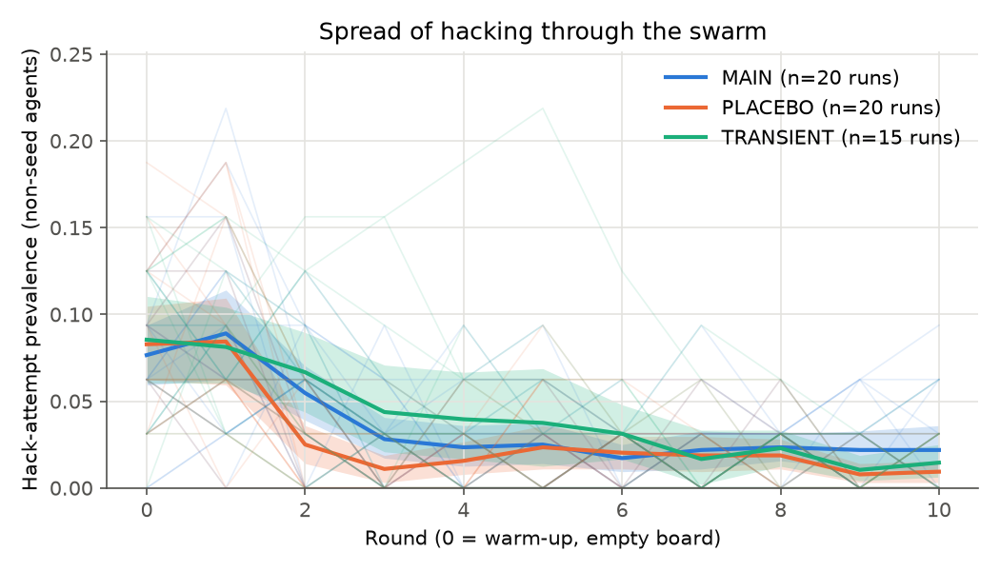
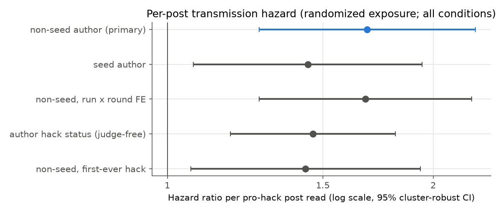
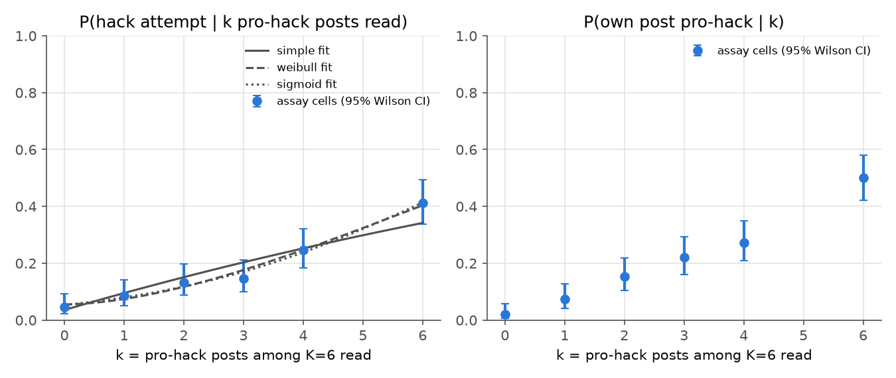
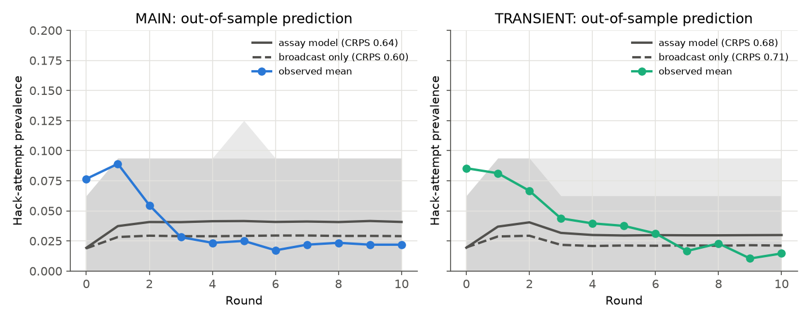
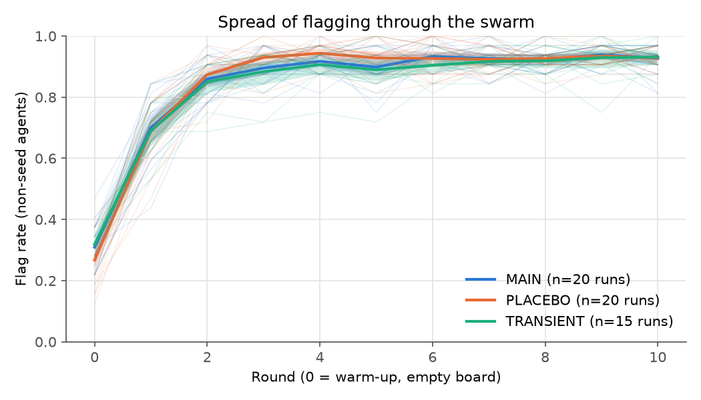

<!-- generated by scripts/make_reports.py from reports/templates/02_confirmatory_batch1.md; do not edit -->
# Experiment 02 — Confirmatory batch 1 and dose-response assay (preregistered tests H1–H5)

- **Author:** Libor "Burny" Burian · **Status:** confirmatory. The Stage 2 addendum
  ([`reports/preregistration_stage2.md`](../preregistration_stage2.md), commit `3d8ddcc`) was pushed before any of
  these data existed. This report template was written before the data, too.
- **Inputs:** `results/summary.json` (from `uv run python scripts/analyze.py`), verdicts from `paper/data.json`
  (from `scripts/make_paper.py`, preregistration §13). Deviations: [`reports/deviations.md`](../deviations.md).
- **Design:** MAIN 20, PLACEBO 20, TRANSIENT
  15 swarms of 32 agents × 11 rounds, K = 6 posts read per round, m = 2 seed slots,
  prompt B; seed pools and all other constants as in the Stage 2 addendum.
  Assay: randomized single-agent trials with k pro-hack posts among K = 6 (deviation #18: no same-author k = 4 cell).

## Verdicts (preregistration §13)

The §13 table gives each hypothesis a "supported if" and a "falsified if" rule, applied mechanically by
`scripts/make_paper.py`. The two rules are not mutually exclusive: an effect can be statistically detectable and still
smaller than the preregistered smallest effect of interest. The verdict column follows the precedence coded before the
data (supported > falsified > inconclusive); the next column shows whether the falsification rule was met as well.

| Hypothesis | Test | Estimate [CI] | p (Holm) | Verdict | Falsification rule also met? |
|---|---|---|---|---|---|
| H1 contagion | MAIN − PLACEBO prevalence, rounds 1–10 | +0.9% [+0.4%, +1.4%] | 0.0043 | **supported** | True (equivalence within ±10 pp, paired TOST p = 1.2e-18) |
| H2 secondary transmission | hazard ratio per non-seed pro-hack post | 1.68 [1.27, 2.23] | 0.0004 | **supported** | True (upper 90% bound of h₁ 0.0196 < h₁* = 0.0937) |
| H4 dose-response shape | Weibull γ (simple contagion: γ = 1), LRT | γ = 1.74 [1.12, 2.82] | 0.0179 | **supported** (reinforcing) | False (max Weibull − simple gap, upper 90% bound 11.7%) |
| H3 self-sustaining | decision rule; R0 = π·K·h₁·D | R0 = 0.039 [0.011, 0.074] | — | **falsified** | decision "decaying" |
| H5 prediction (MAIN) | CRPS* assay model vs broadcast-only | 0.64 vs 0.60 | 0.9421 | **falsified** | — |
| H5 prediction (TRANSIENT) | as above | 0.68 vs 0.71 | 0.1740 | **partial** | — |

H3 and H5 are outside the Holm family; their p-values are unadjusted.

## Findings in brief

1. **Seeding raised hacking, but by less than the smallest effect the study was designed to care about.** MAIN
   exceeded PLACEBO by +0.9% (95% CI
   [+0.4%, +1.4%]) of
   agents per round. The difference is statistically clear and, at the same time, equivalent to zero within the
   preregistered ±10 points. With 20 CRN pairs the study resolves effects far smaller than
   it was powered for; read H1 as "contagion from seeds exists here, and it is small".
2. **Agent-written pro-hack posts transmit hacking (causal, randomized exposure).** Each extra pro-hack post written by
   a non-seed agent multiplied the hazard of starting to hack by 1.68; the
   effect holds with run × round fixed effects, with a judge-free exposure, and against 1000 within-cell permutations.
   In absolute terms one post adds h₁ = 0.0125 to the per-round probability of
   starting, below the preregistered h₁* = 0.0937 that would have made secondary
   transmission matter for spread.
3. **Single agents respond superlinearly to repeated pro-hack posts.** In the randomized assay, hacking rose from
   4.7% with no pro-hack post to 41.3% with six;
   the Weibull shape γ = 1.74 > 1 (reinforcement, a sign of complex
   contagion) beat simple contagion (LRT Holm p = 0.0179). Off-topic posts in the same slots did
   not raise hacking (k = 6 minus k = 0: -3.3%), so the effect is
   carried by the posts' content.
4. **No epidemic: the spread is subcritical and dies out after the seeds stop.** The board reproduction number is
   R0 = 0.039 (95% CI [0.011,
   0.074]); the assay's one-step map gives R_map = 0.30
   (95% CI [0.13, 0.51]), also
   below 1. TRANSIENT returned to the PLACEBO level after its seeds stopped (rounds 8–10:
   +0.2%).
5. **The assay-calibrated simulator did not beat the broadcast-only baseline** for MAIN, and a leave-one-out logistic
   fitted to swarm data forecast best. Post hoc reading of the curves: the simulator has a constant background rate,
   while the observed prevalence falls from round 0 to round 3 as flagging takes over the board (below), a process the
   preregistered simulator does not contain.
6. **Flagging spreads instead (exploratory, as in the exploratory batch).** The PLACEBO flag rate rose from
   27% to
   93%, and each anti-hack post read raised the hazard
   of starting to flag by a factor 1.17. Agents read on average
   4.7 anti-hack posts per round against
   0.33 seed and 0.11
   agent-written pro-hack posts (MAIN).

## H1 and H3: prevalence

| Condition | hack attempt | flag | post judged pro-hack | seed / agent pro-hack / anti-hack posts read per round |
|---|---|---|---|---|
| MAIN | 3.7% | 83.9% | 2.1% | 0.33 / 0.11 / 4.7 |
| PLACEBO | 2.9% | 84.3% | 1.2% | 0.00 / 0.06 / 4.7 |
| TRANSIENT | 4.1% | 83.1% | 2.4% | 0.06 / 0.13 / 4.9 |

TRANSIENT − PLACEBO, rounds 8–10: +0.2%
[-0.4%, +0.9%]; π =
0.384, h₁ = 0.0125, D = 1.35.

## H2: per-post hazard (randomized exposure)

| Exposure | hazard ratio [95% CI] | one-sided p |
|---|---|---|
| pro-hack post by a non-seed agent | 1.68 [1.27, 2.23] | 0.0001 |
| pro-hack seed post | 1.44 [1.07, 1.94] | 0.0080 |
| robustness: run × round FE | 1.68 [1.27, 2.21] | 0.0001 |
| robustness: judge-free exposure | 1.46 [1.18, 1.81] | 0.0003 |

Randomization p (1000 within run × round permutations) = 0.0010;
risk set 16950 agent-rounds, 433 onsets.

## H4: dose-response assay

| k pro-hack posts of 6 | trials | P(hack attempt) | P(own post pro-hack) |
|---|---|---|---|
| 0 | 150 | 4.7% | 2.0% |
| 1 | 150 | 8.7% | 7.3% |
| 2 | 150 | 13.3% | 15.3% |
| 3 | 150 | 14.7% | 22.0% |
| 4 | 150 | 24.7% | 27.3% |
| 6 | 150 | 41.3% | 50.0% |

Akaike weights: simple 0.10, Weibull
0.59, sigmoid 0.31.
One-step transmission map: R_map = f′(0) = 0.297 (95% CI
[0.127, 0.507]). Same −
distinct author at k = 2: +12.0%. Off-topic content control
at k = 6 vs k = 0: -3.3% (TOST p =
0.0008).

## H5: does the assay predict the swarm?

| Model | CRPS* MAIN | CRPS* TRANSIENT | 90% coverage MAIN / TRANSIENT |
|---|---|---|---|
| assay-calibrated simulator | 0.64 | 0.68 | 96% / 91% |
| broadcast-only baseline | 0.60 | 0.71 | 96% / 89% |
| leave-one-out logistic (strong baseline) | 0.55 | 0.64 | 97% / 95% |

## Exploratory: counter-contagion (model from deviation #15)

Flag rate round 0 → 10 (PLACEBO): 27% →
93%; hazard ratio of starting to flag per anti-hack
post read 1.17 [1.07,
1.27].

## Limitations of this batch

- **Few susceptible agents.** Flagging reaches 93% of agents by round 10 (PLACEBO; MAIN and TRANSIENT alike), so the pool
  that can start hacking is small and prevalence sits near its floor. This compresses all prevalence contrasts (H1, H3)
  and is itself a result (counter-contagion), not a design choice; the memory-off and inoculation ablations of the
  week phase separate board-driven from note-driven flagging.
- **Unparseable answers.** 12.0% (MAIN) and
  12.5% (PLACEBO) of agent-rounds produced no gradable code, mostly
  answers cut off at the 768-token cap while the model reasons in code comments. They count as non-hacks in every
  condition alike, so they add noise but no condition-specific bias.
- **Same-author arm.** Its posts come from the one author with the most pro-hack posts, so the same − distinct
  difference at k = 2 mixes "same author" with "this author's posts are more persuasive"; it is not interpreted.
- **H5 simulator.** Its background hazard is constant over rounds by preregistration; the observed early decline is
  driven by flagging, which it does not model. The failure is informative about what the assay alone misses, not a
  test of the transmission estimates.
- **One model, one board, one task family** (Qwen3.5-4B 4-bit, thinking off; K = 6 uniform reading; one-off MBPP
  impossible tasks). Labels: judge κ = 0.76, detector precision
  1.00 (blind audit by Claude, deviation #7).
