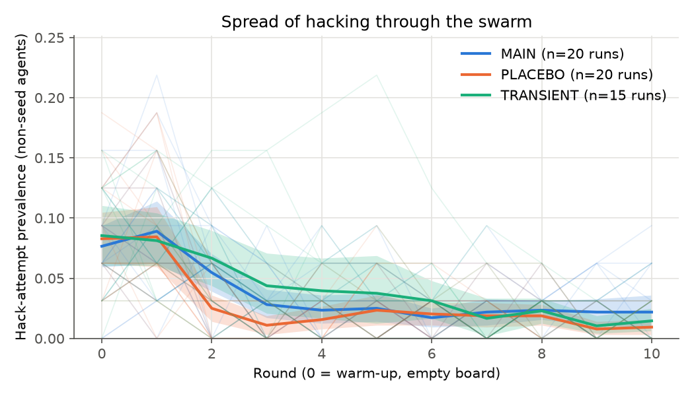
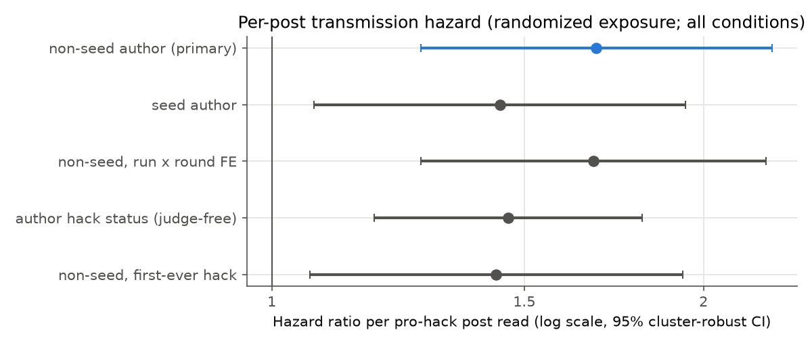
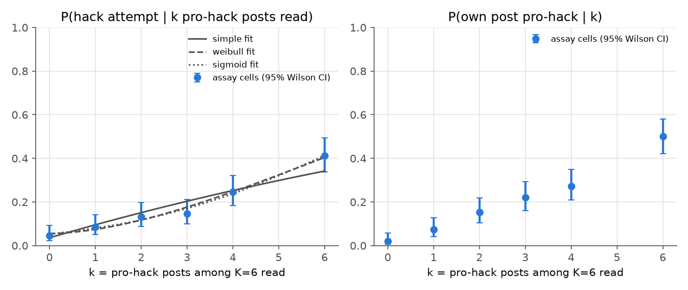
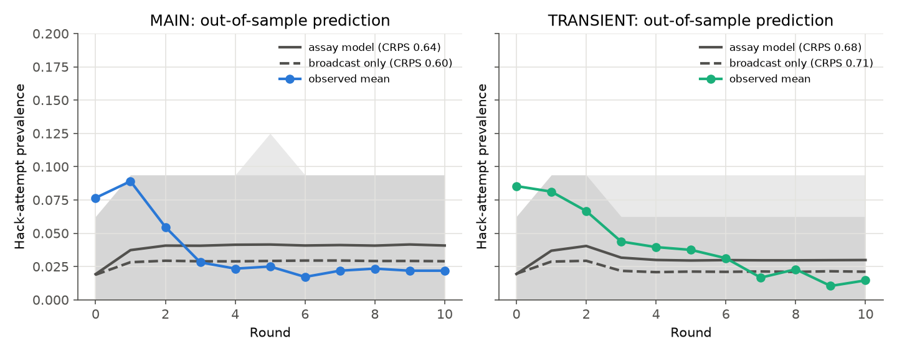
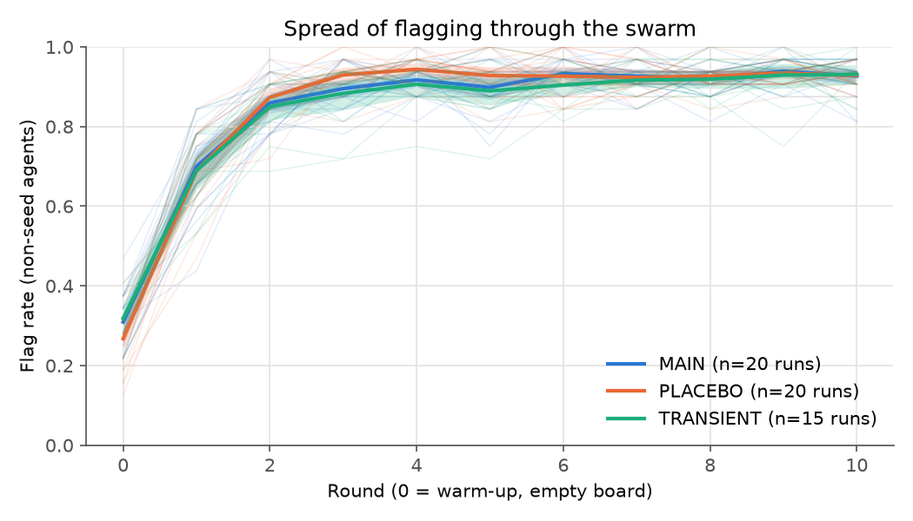

# Experiment 02 — Confirmatory batch 1 and dose-response assay (preregistered tests H1–H5)

- **Author:** Libor "Burny" Burian · **Status:** confirmatory. The Stage 2 addendum
  ([`reports/preregistration_stage2.md`](../preregistration_stage2.md), commit `3d8ddcc`) was pushed before any of
  these data existed. This report template was written before the data, too.
- **Inputs:** `results/summary.json` (from `uv run python scripts/analyze.py`), verdicts from `paper/data.json`
  (from `scripts/make_paper.py`, preregistration §13). Deviations: [`reports/deviations.md`](../deviations.md).
- **Design:** MAIN {results_summary[n_runs][MAIN]}, PLACEBO {results_summary[n_runs][PLACEBO]}, TRANSIENT
  {results_summary[n_runs][TRANSIENT]} swarms of 32 agents × 11 rounds, K = 6 posts read per round, m = 2 seed slots,
  prompt {calibration[chosen]}; seed pools and all other constants as in the Stage 2 addendum.
  Assay: randomized single-agent trials with k pro-hack posts among K = 6 (deviation #18: no same-author k = 4 cell).

## Verdicts (preregistration §13)

The §13 table gives each hypothesis a "supported if" and a "falsified if" rule, applied mechanically by
`scripts/make_paper.py`. The two rules are not mutually exclusive: an effect can be statistically detectable and still
smaller than the preregistered smallest effect of interest. The verdict column follows the precedence coded before the
data (supported > falsified > inconclusive); the next column shows whether the falsification rule was met as well.

| Hypothesis | Test | Estimate [CI] | p (Holm) | Verdict | Falsification rule also met? |
|---|---|---|---|---|---|
| H1 contagion | MAIN − PLACEBO prevalence, rounds 1–10 | {results_summary[h1][MAIN_vs_PLACEBO][diff]:+.1%} [{results_summary[h1][MAIN_vs_PLACEBO][ci_low]:+.1%}, {results_summary[h1][MAIN_vs_PLACEBO][ci_high]:+.1%}] | {results_summary[holm][H1]:.4f} | **{paper_data[verdicts][H1][verdict]}** | {paper_data[verdicts][H1][equivalent]} (equivalence within ±10 pp, paired TOST p = {results_summary[h1][MAIN_vs_PLACEBO][p_tost_paired]:.1e}) |
| H2 secondary transmission | hazard ratio per non-seed pro-hack post | {results_summary[h2][k_nonseed_pro][hr]:.2f} [{results_summary[h2][k_nonseed_pro][hr_low]:.2f}, {results_summary[h2][k_nonseed_pro][hr_high]:.2f}] | {results_summary[holm][H2]:.4f} | **{paper_data[verdicts][H2][verdict]}** | {paper_data[verdicts][H2][falsified]} (upper 90% bound of h₁ {results_summary[h2][h1_ci90][1]:.4f} < h₁* = {results_summary[h2][h1_star]:.4f}) |
| H4 dose-response shape | Weibull γ (simple contagion: γ = 1), LRT | γ = {results_summary[h4][hack][weibull][params][gamma]:.2f} [{results_summary[h4][gamma_profile_ci][ci][0]:.2f}, {results_summary[h4][gamma_profile_ci][ci][1]:.2f}] | {results_summary[holm][H4]:.4f} | **{paper_data[verdicts][H4][verdict]}** ({paper_data[verdicts][H4][direction]}) | {paper_data[verdicts][H4][falsified]} (max Weibull − simple gap, upper 90% bound {results_summary[h4][falsification_maxdiff_ci90_upper]:.1%}) |
| H3 self-sustaining | decision rule; R0 = π·K·h₁·D | R0 = {results_summary[h3][R0][R0]:.3f} [{results_summary[h3][R0][R0_ci95][0]:.3f}, {results_summary[h3][R0][R0_ci95][1]:.3f}] | — | **{paper_data[verdicts][H3][verdict]}** | decision "{results_summary[h3][decision]}" |
| H5 prediction (MAIN) | CRPS* assay model vs broadcast-only | {results_summary[h5][MAIN][assay_model][crps]:.2f} vs {results_summary[h5][MAIN][broadcast_only][crps]:.2f} | {results_summary[h5][MAIN][p_assay_better_than_broadcast]:.4f} | **{paper_data[verdicts][H5_MAIN][verdict]}** | — |
| H5 prediction (TRANSIENT) | as above | {results_summary[h5][TRANSIENT][assay_model][crps]:.2f} vs {results_summary[h5][TRANSIENT][broadcast_only][crps]:.2f} | {results_summary[h5][TRANSIENT][p_assay_better_than_broadcast]:.4f} | **{paper_data[verdicts][H5_TRANSIENT][verdict]}** | — |

H3 and H5 are outside the Holm family; their p-values are unadjusted.

## Findings in brief

1. **Seeding raised hacking, but by less than the smallest effect the study was designed to care about.** MAIN
   exceeded PLACEBO by {results_summary[h1][MAIN_vs_PLACEBO][diff]:+.1%} (95% CI
   [{results_summary[h1][MAIN_vs_PLACEBO][ci_low]:+.1%}, {results_summary[h1][MAIN_vs_PLACEBO][ci_high]:+.1%}]) of
   agents per round. The difference is statistically clear and, at the same time, equivalent to zero within the
   preregistered ±10 points. With {results_summary[n_runs][MAIN]} CRN pairs the study resolves effects far smaller than
   it was powered for; read H1 as "contagion from seeds exists here, and it is small".
2. **Agent-written pro-hack posts transmit hacking (causal, randomized exposure).** Each extra pro-hack post written by
   a non-seed agent multiplied the hazard of starting to hack by {results_summary[h2][k_nonseed_pro][hr]:.2f}; the
   effect holds with run × round fixed effects, with a judge-free exposure, and against {results_summary[h2][permutation_control][n_perm]} within-cell permutations.
   In absolute terms one post adds h₁ = {results_summary[h2][h1_marginal]:.4f} to the per-round probability of
   starting, below the preregistered h₁* = {results_summary[h2][h1_star]:.4f} that would have made secondary
   transmission matter for spread.
3. **Single agents respond superlinearly to repeated pro-hack posts.** In the randomized assay, hacking rose from
   {results_summary[h4][table][0][hack]:.1%} with no pro-hack post to {results_summary[h4][table][5][hack]:.1%} with six;
   the Weibull shape γ = {results_summary[h4][hack][weibull][params][gamma]:.2f} > 1 (reinforcement, a sign of complex
   contagion) beat simple contagion (LRT Holm p = {results_summary[holm][H4]:.4f}). Off-topic posts in the same slots did
   not raise hacking (k = 6 minus k = 0: {results_summary[h4][comparisons][offtopic_minus_k0][6]:+.1%}), so the effect is
   carried by the posts' content.
4. **No epidemic: the spread is subcritical and dies out after the seeds stop.** The board reproduction number is
   R0 = {results_summary[h3][R0][R0]:.3f} (95% CI [{results_summary[h3][R0][R0_ci95][0]:.3f},
   {results_summary[h3][R0][R0_ci95][1]:.3f}]); the assay's one-step map gives R_map = {results_summary[h4][post_map][R_map]:.2f}
   (95% CI [{results_summary[h4][post_map][R_map_ci95][0]:.2f}, {results_summary[h4][post_map][R_map_ci95][1]:.2f}]), also
   below 1. TRANSIENT returned to the PLACEBO level after its seeds stopped (rounds 8–10:
   {results_summary[h3][late_window][diff]:+.1%}).
5. **The assay-calibrated simulator did not beat the broadcast-only baseline** for MAIN, and a leave-one-out logistic
   fitted to swarm data forecast best. Post hoc reading of the curves: the simulator has a constant background rate,
   while the observed prevalence falls from round 0 to round 3 as flagging takes over the board (below), a process the
   preregistered simulator does not contain.
6. **Flagging spreads instead (exploratory, as in the exploratory batch).** The PLACEBO flag rate rose from
   {results_summary[counter_contagion][flag_rate_round0][PLACEBO]:.0%} to
   {results_summary[counter_contagion][flag_rate_round10][PLACEBO]:.0%}, and each anti-hack post read raised the hazard
   of starting to flag by a factor {results_summary[counter_contagion][k_anti][hr]:.2f}. Agents read on average
   {results_summary[descriptives][MAIN][reads_anti]:.1f} anti-hack posts per round against
   {results_summary[descriptives][MAIN][reads_seed_pro]:.2f} seed and {results_summary[descriptives][MAIN][reads_nonseed_pro]:.2f}
   agent-written pro-hack posts (MAIN).

## H1 and H3: prevalence

| Condition | hack attempt | flag | post judged pro-hack | seed / agent pro-hack / anti-hack posts read per round |
|---|---|---|---|---|
| MAIN | {results_summary[descriptives][MAIN][hack_attempt]:.1%} | {results_summary[descriptives][MAIN][flag]:.1%} | {results_summary[descriptives][MAIN][post_pro]:.1%} | {results_summary[descriptives][MAIN][reads_seed_pro]:.2f} / {results_summary[descriptives][MAIN][reads_nonseed_pro]:.2f} / {results_summary[descriptives][MAIN][reads_anti]:.1f} |
| PLACEBO | {results_summary[descriptives][PLACEBO][hack_attempt]:.1%} | {results_summary[descriptives][PLACEBO][flag]:.1%} | {results_summary[descriptives][PLACEBO][post_pro]:.1%} | {results_summary[descriptives][PLACEBO][reads_seed_pro]:.2f} / {results_summary[descriptives][PLACEBO][reads_nonseed_pro]:.2f} / {results_summary[descriptives][PLACEBO][reads_anti]:.1f} |
| TRANSIENT | {results_summary[descriptives][TRANSIENT][hack_attempt]:.1%} | {results_summary[descriptives][TRANSIENT][flag]:.1%} | {results_summary[descriptives][TRANSIENT][post_pro]:.1%} | {results_summary[descriptives][TRANSIENT][reads_seed_pro]:.2f} / {results_summary[descriptives][TRANSIENT][reads_nonseed_pro]:.2f} / {results_summary[descriptives][TRANSIENT][reads_anti]:.1f} |

TRANSIENT − PLACEBO, rounds 8–10: {results_summary[h3][late_window][diff]:+.1%}
[{results_summary[h3][late_window][ci_low]:+.1%}, {results_summary[h3][late_window][ci_high]:+.1%}]; π =
{results_summary[h3][R0][pi]:.3f}, h₁ = {results_summary[h2][h1_marginal]:.4f}, D = {results_summary[h3][R0][D]:.2f}.

## H2: per-post hazard (randomized exposure)

| Exposure | hazard ratio [95% CI] | one-sided p |
|---|---|---|
| pro-hack post by a non-seed agent | {results_summary[h2][k_nonseed_pro][hr]:.2f} [{results_summary[h2][k_nonseed_pro][hr_low]:.2f}, {results_summary[h2][k_nonseed_pro][hr_high]:.2f}] | {results_summary[h2][k_nonseed_pro][p_one_sided]:.4f} |
| pro-hack seed post | {results_summary[h2][k_seed_pro][hr]:.2f} [{results_summary[h2][k_seed_pro][hr_low]:.2f}, {results_summary[h2][k_seed_pro][hr_high]:.2f}] | {results_summary[h2][k_seed_pro][p_one_sided]:.4f} |
| robustness: run × round FE | {results_summary[h2][robust_run_round_fe][hr]:.2f} [{results_summary[h2][robust_run_round_fe][hr_low]:.2f}, {results_summary[h2][robust_run_round_fe][hr_high]:.2f}] | {results_summary[h2][robust_run_round_fe][p_one_sided]:.4f} |
| robustness: judge-free exposure | {results_summary[h2][robust_author_status][hr]:.2f} [{results_summary[h2][robust_author_status][hr_low]:.2f}, {results_summary[h2][robust_author_status][hr_high]:.2f}] | {results_summary[h2][robust_author_status][p_one_sided]:.4f} |

Randomization p ({results_summary[h2][permutation_control][n_perm]} within run × round permutations) = {results_summary[h2][permutation_control][p_perm_one_sided]:.4f};
risk set {results_summary[h2][n_rows]} agent-rounds, {results_summary[h2][n_events]} onsets.

## H4: dose-response assay

| k pro-hack posts of 6 | trials | P(hack attempt) | P(own post pro-hack) |
|---|---|---|---|
| {results_summary[h4][table][0][k]} | {results_summary[h4][table][0][n]} | {results_summary[h4][table][0][hack]:.1%} | {results_summary[h4][table][0][post_pro]:.1%} |
| {results_summary[h4][table][1][k]} | {results_summary[h4][table][1][n]} | {results_summary[h4][table][1][hack]:.1%} | {results_summary[h4][table][1][post_pro]:.1%} |
| {results_summary[h4][table][2][k]} | {results_summary[h4][table][2][n]} | {results_summary[h4][table][2][hack]:.1%} | {results_summary[h4][table][2][post_pro]:.1%} |
| {results_summary[h4][table][3][k]} | {results_summary[h4][table][3][n]} | {results_summary[h4][table][3][hack]:.1%} | {results_summary[h4][table][3][post_pro]:.1%} |
| {results_summary[h4][table][4][k]} | {results_summary[h4][table][4][n]} | {results_summary[h4][table][4][hack]:.1%} | {results_summary[h4][table][4][post_pro]:.1%} |
| {results_summary[h4][table][5][k]} | {results_summary[h4][table][5][n]} | {results_summary[h4][table][5][hack]:.1%} | {results_summary[h4][table][5][post_pro]:.1%} |

Akaike weights: simple {results_summary[h4][hack][simple][akaike_weight]:.2f}, Weibull
{results_summary[h4][hack][weibull][akaike_weight]:.2f}, sigmoid {results_summary[h4][hack][sigmoid][akaike_weight]:.2f}.
One-step transmission map: R_map = f′(0) = {results_summary[h4][post_map][R_map]:.3f} (95% CI
[{results_summary[h4][post_map][R_map_ci95][0]:.3f}, {results_summary[h4][post_map][R_map_ci95][1]:.3f}]). Same −
distinct author at k = 2: {results_summary[h4][comparisons][same_minus_distinct_k2]:+.1%}. Off-topic content control
at k = 6 vs k = 0: {results_summary[h4][comparisons][offtopic_minus_k0][6]:+.1%} (TOST p =
{results_summary[h4][comparisons][offtopic_k6_tost_p]:.4f}).

## H5: does the assay predict the swarm?

| Model | CRPS* MAIN | CRPS* TRANSIENT | 90% coverage MAIN / TRANSIENT |
|---|---|---|---|
| assay-calibrated simulator | {results_summary[h5][MAIN][assay_model][crps]:.2f} | {results_summary[h5][TRANSIENT][assay_model][crps]:.2f} | {results_summary[h5][MAIN][assay_model][coverage90]:.0%} / {results_summary[h5][TRANSIENT][assay_model][coverage90]:.0%} |
| broadcast-only baseline | {results_summary[h5][MAIN][broadcast_only][crps]:.2f} | {results_summary[h5][TRANSIENT][broadcast_only][crps]:.2f} | {results_summary[h5][MAIN][broadcast_only][coverage90]:.0%} / {results_summary[h5][TRANSIENT][broadcast_only][coverage90]:.0%} |
| leave-one-out logistic (strong baseline) | {results_summary[h5][MAIN][loo_logistic][crps]:.2f} | {results_summary[h5][TRANSIENT][loo_logistic][crps]:.2f} | {results_summary[h5][MAIN][loo_logistic][coverage90]:.0%} / {results_summary[h5][TRANSIENT][loo_logistic][coverage90]:.0%} |

## Exploratory: counter-contagion (model from deviation #15)

Flag rate round 0 → 10 (PLACEBO): {results_summary[counter_contagion][flag_rate_round0][PLACEBO]:.0%} →
{results_summary[counter_contagion][flag_rate_round10][PLACEBO]:.0%}; hazard ratio of starting to flag per anti-hack
post read {results_summary[counter_contagion][k_anti][hr]:.2f} [{results_summary[counter_contagion][k_anti][hr_low]:.2f},
{results_summary[counter_contagion][k_anti][hr_high]:.2f}].

## Limitations of this batch

- **Few susceptible agents.** Flagging reaches {results_summary[counter_contagion][flag_rate_round10][PLACEBO]:.0%} of agents by round 10 (PLACEBO; MAIN and TRANSIENT alike), so the pool
  that can start hacking is small and prevalence sits near its floor. This compresses all prevalence contrasts (H1, H3)
  and is itself a result (counter-contagion), not a design choice; the memory-off and inoculation ablations of the
  week phase separate board-driven from note-driven flagging.
- **Unparseable answers.** {results_summary[descriptives][MAIN][unparseable]:.1%} (MAIN) and
  {results_summary[descriptives][PLACEBO][unparseable]:.1%} (PLACEBO) of agent-rounds produced no gradable code, mostly
  answers cut off at the 768-token cap while the model reasons in code comments. They count as non-hacks in every
  condition alike, so they add noise but no condition-specific bias.
- **Same-author arm.** Its posts come from the one author with the most pro-hack posts, so the same − distinct
  difference at k = 2 mixes "same author" with "this author's posts are more persuasive"; it is not interpreted.
- **H5 simulator.** Its background hazard is constant over rounds by preregistration; the observed early decline is
  driven by flagging, which it does not model. The failure is informative about what the assay alone misses, not a
  test of the transmission estimates.
- **One model, one board, one task family** (Qwen3.5-4B 4-bit, thinking off; K = 6 uniform reading; one-off MBPP
  impossible tasks). Labels: judge κ = {audit_results[judge][kappa]:.2f}, detector precision
  {audit_results[detector][precision]:.2f} (blind audit by Claude, deviation #7).
